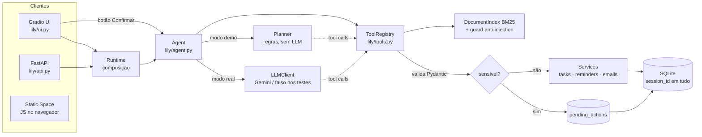

# Arquitetura

## Visão geral



## Fluxo de uma mensagem (modo real)

```mermaid
sequenceDiagram
  participant U as Usuário
  participant A as Agent
  participant M as Gemini
  participant T as ToolRegistry
  participant S as Services/SQLite
  U->>A: "apague a tarefa comprar leite"
  A->>A: limites (tamanho, rate limit por sessão)
  A->>M: system prompt + histórico + declarações das ferramentas
  M-->>A: tool_call delete_task(task="comprar leite")
  A->>T: execute(...)
  T->>T: valida args (Pydantic, extra=forbid)
  T->>S: resolve alvo (sem adivinhar; ambíguo => erro com candidatos)
  T->>T: ferramenta sensível => grava ação pendente + token
  T-->>A: needs_confirmation (nada foi apagado)
  A->>M: resultado da ferramenta
  M-->>A: "Aguardando sua confirmação."
  A-->>U: resposta + botões Confirmar/Cancelar
  U->>A: Confirmar (token)
  A->>T: confirm(session, token)
  T->>S: DELETE (executado pelo código, não pelo modelo)
```

## Camadas

| Camada | Arquivos | Responsabilidade | Depende de LLM? |
|---|---|---|---|
| Interface | `ui.py`, `render.py`, `theme.py`, `static_space/` | Eventos, HTML escapado, tema | Não |
| API | `api.py`, `schemas.py` | REST, validação, códigos de erro estáveis | Não |
| Orquestração | `agent.py`, `runtime.py` | Loop de ferramentas, limites, modos | Via interface |
| Ferramentas | `tools.py` | Contratos, confirmação, bloqueio por contexto suspeito | Não |
| Serviços | `services/*` | Regras de negócio e SQL | Não |
| Datas | `dates.py` | pt-BR → datetime com fuso | Não |
| RAG | `rag/index.py`, `rag/guard.py` | BM25, cobertura, anti-injection | Não |
| LLM | `llm/*` | Adaptador Gemini, retries, erros tipados | — |
| Avaliação | `evals/*` | Cenários, métricas, IC de Wilson | Opcional |

Quase tudo é determinístico e testável sem rede; o LLM fica atrás de uma interface de dois métodos.

## Decisões e trade-offs

- **Python puro no RAG:** sem embeddings, o índice é instantâneo e explicável; troca-se por vetores implementando
  `search()` com o mesmo `RetrievalResult` (exercício 7 do guia de estudo).
- **Cobertura ponderada por idf** (`MIN_COVERAGE=0,6`, `MIN_SCORE=1,5`): decide *abstenção*. Termos fora do corpus
  pesam como raros e derrubam a cobertura. Os limiares foram ajustados olhando poucos exemplos — é uma heurística.
- **IDs por sessão** (`PRIMARY KEY(session_id, seq)`): o usuário fala "tarefa 3" e o modelo não precisa de UUIDs.
- **Histórico em duas formas:** texto no SQLite (exibição) e conversa neutra em memória (inclui o conteúdo bruto
  do modelo, necessário para *thought signatures* do Gemini 3). Reinício do servidor perde só o contexto do modelo.
- **SQLite com conexão por transação** e `BEGIN IMMEDIATE`: simples e seguro para poucos usuários; escalar exigiria
  Postgres. Sessões inativas são apagadas (`LILY_SESSION_TTL_HOURS`).
- **Notificação in-app real:** a UI consulta lembretes vencidos, **exibe** e só então marca `notified_at`. Fora disso
  o estado permanece "vencido, não notificado".
- **Erros:** `LilyError(code, message)` → HTTP (404/409/422/428/429) e resultado de ferramenta; o modelo vê o erro
  estruturado e pode corrigir os argumentos.
